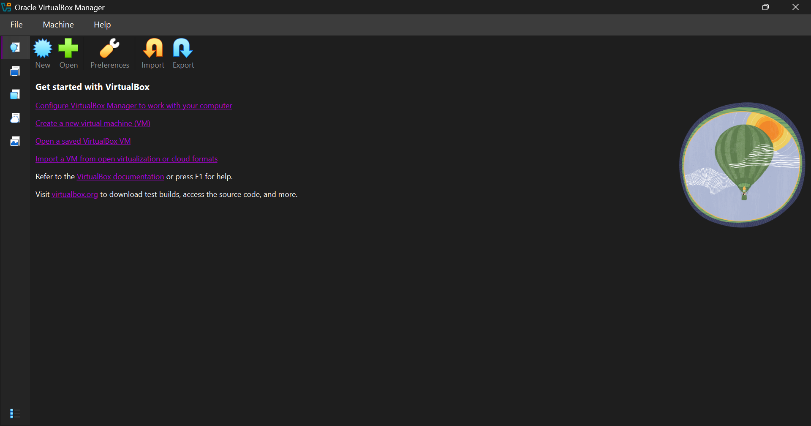
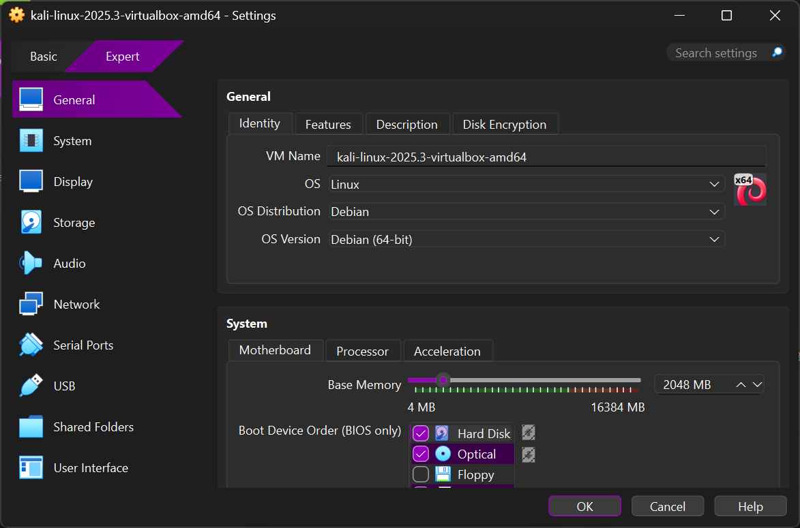
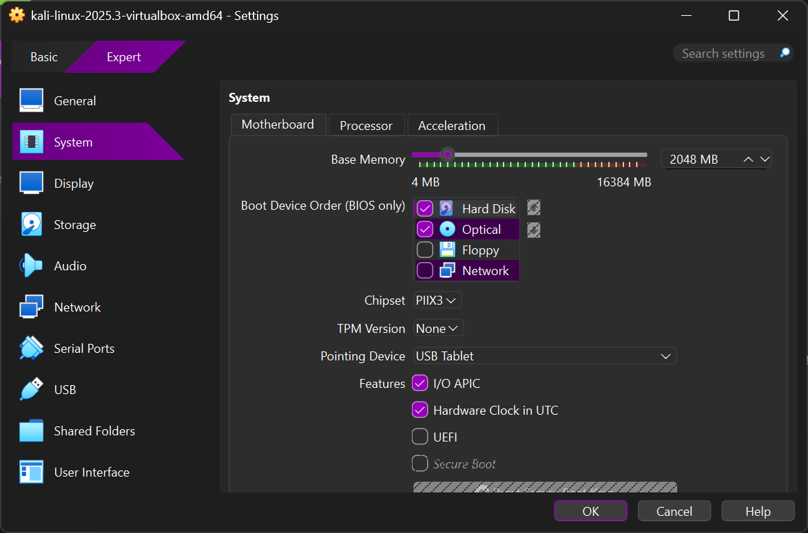
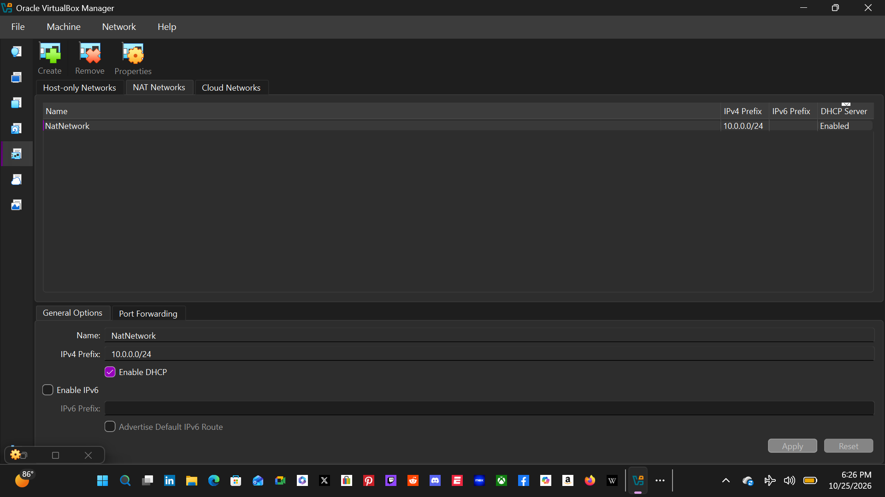
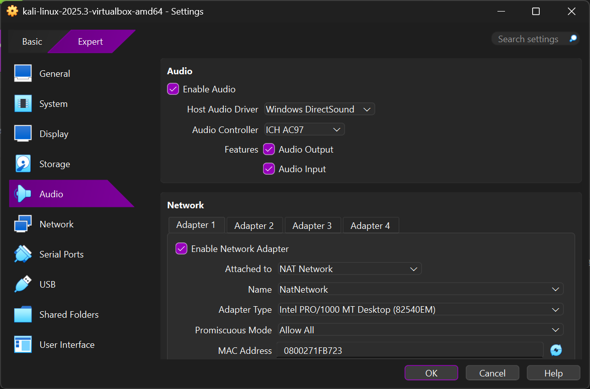
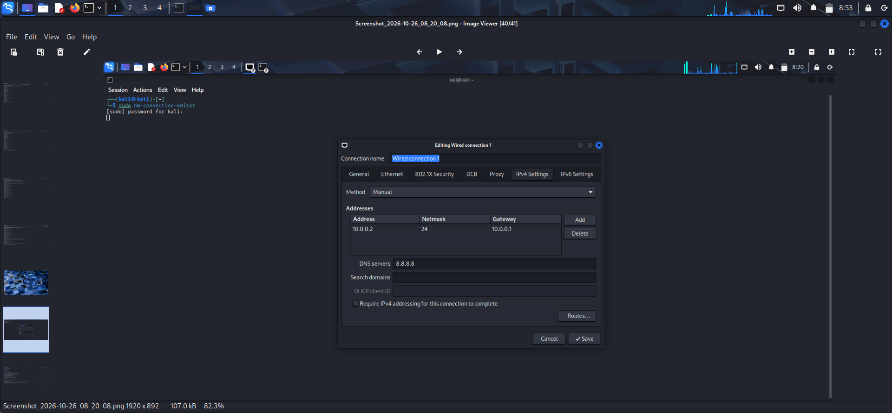
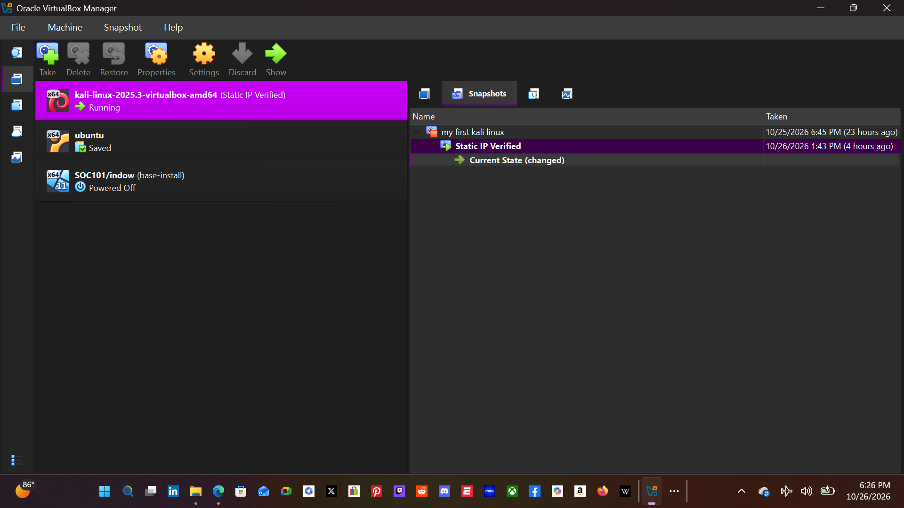
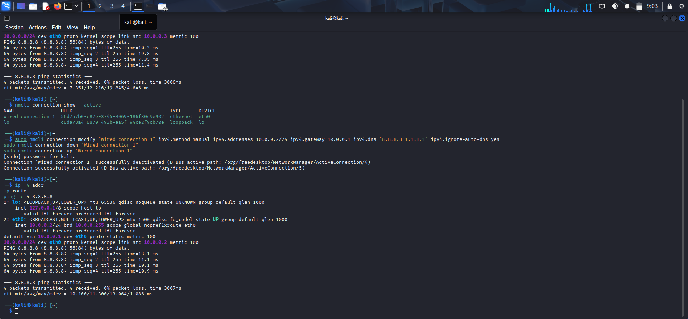
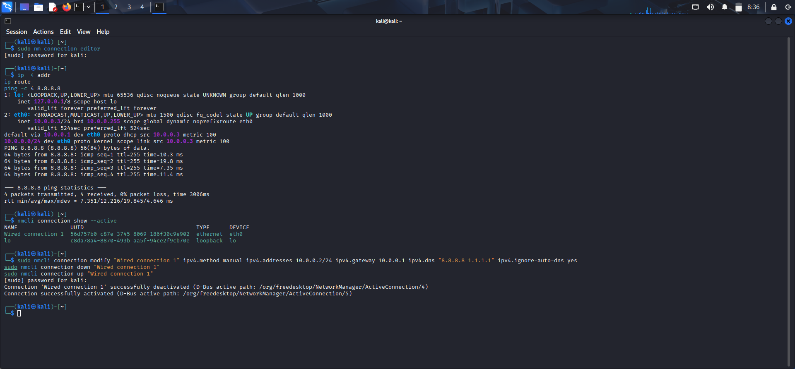
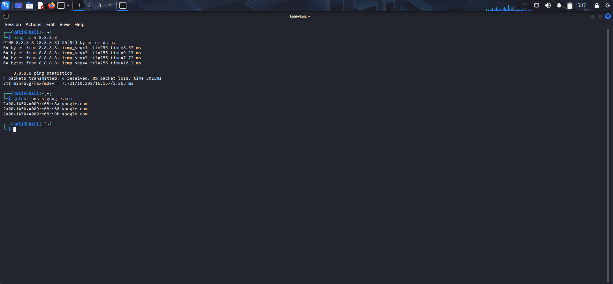

</div>
<p align="center">
  
  
  
  
  
  
  
  
  
  
  
 
</p>


## 🛡️ Project Overview

This project documents how I built and verified my Kali Linux virtual machine in Oracle VirtualBox, including the NAT Network, static IPv4 configuration, troubleshooting, and test evidence.

## 🎯 Purpose of the Lab

I created this virtual lab to learn Linux networking and cybersecurity fundamentals in a controlled environment. I will use it only for systems I own or have permission to test.

## 🏗️ Lab Architecture

The Kali VM connects to my VirtualBox NAT Network. The current lab network is `10.0.0.0/24`; Kali uses `10.0.0.2/24` and gateway `10.0.0.1`. Additional lab VMs can be added later.

**Windows host** → **Oracle VirtualBox** → **NAT Network** (`10.0.0.0/24`) → **Kali Linux VM** (`10.0.0.2/24`)

> The repositories in Credits were references for the topic and documentation structure. The configuration, screenshots, and results below are from my own lab.

## ⚙️ Lab Configuration

| Component | My setup |
|---|---|
| Host operating system | Windows 11 |
| Hypervisor | Oracle VirtualBox 7.2 |
| Virtual machine | Kali Linux 2025.3 |
| Kali memory | 2048 MB |
| Network mode | NAT Network |
| NAT Network name | `NatNetwork` |
| IPv4 network | `10.0.0.0/24` |
| NAT DHCP | Enabled on the VirtualBox network |
| Kali IPv4 configuration | Manual/static |
| Kali address | `10.0.0.2/24` |
| Gateway | `10.0.0.1` |
| DNS servers | `8.8.8.8`, `1.1.1.1` |
| Snapshot | `Static IP Verified` |

## 🪜 Setup walkthrough

### 1. VirtualBox Manager

I used VirtualBox Manager to manage the Kali virtual machine and NAT Network.



### 2. Kali virtual machine

The VM is Kali Linux 2025.3 with 2048 MB of memory.





### 3. NAT Network

I created a NAT Network named `NatNetwork` with the IPv4 prefix `10.0.0.0/24`. DHCP is enabled on the VirtualBox network and IPv6 is disabled.



### 4. Kali network adapter

Adapter 1 connects Kali to the `NatNetwork` using the Intel PRO/1000 MT Desktop adapter. Promiscuous Mode is currently set to **Deny**. The saved screenshot shows the earlier **Allow All** setting.



### 5. Static IPv4 settings

I configured `Wired connection 1` with address `10.0.0.2/24`, gateway `10.0.0.1`, and DNS servers `8.8.8.8` and `1.1.1.1`.



### 6. Snapshot

After verifying the network configuration, I saved a VirtualBox snapshot named `Static IP Verified`.



## ✅ Verification

The terminal evidence shows Kali using the static address `10.0.0.2/24`, with a default route through `10.0.0.1`. Four pings to `8.8.8.8` succeeded with 0% packet loss.



Earlier in the setup, Kali received `10.0.0.3/24` dynamically. This screenshot records the DHCP state before I configured the static address.



I also confirmed that `google.com` resolves and that Kali can reach `8.8.8.8`.



## 🧰 Commands used

```bash
ip -4 addr
ip route
ping -c 4 8.8.8.8
getent hosts google.com
```

## 🐞 Problems I faced and how I solved them

When I first entered the manual IPv4 settings, the editor showed validation errors saying Manual mode needed an address or route and that the netmask was invalid. I set the address to `10.0.0.2/24`, the gateway to `10.0.0.1`, and DNS servers, then used NetworkManager's `nmcli` command to update and reactivate the connection. I verified the result with `ip -4 addr`, `ip route`, a successful ping to `8.8.8.8`, and `getent hosts google.com`.

## 🧠 What I learned

- How a VirtualBox NAT Network differs from standard NAT and provides a private lab network.
- How to configure a static IPv4 address, gateway, and DNS servers in Kali.
- How to verify network settings, connectivity, and DNS from the terminal.
- Why saving a VM snapshot after a working setup provides a recovery point.
- How to document setup steps and troubleshooting clearly.

## 🧰 Tools and resources

- **Oracle VirtualBox:** [Download VirtualBox](https://virtualbox.org/wiki/Downloads)
- **Kali Linux:** [Get Kali Linux](https://kali.org/get-kali)

## 🔐 Safe use

This lab is for learning and authorized testing. I will only test systems I own or have explicit permission to assess.

## 👤 Author

**Kelechi Happiness Uzoma**  
Cybersecurity Intern at NetworkWalks

## 📋 Project information

| Item | Details |
|---|---|
| Program Name | Cybersecurity at NetworkWalks |
| Week | 01 |
| Project | Cybersecurity & Pentesting Lab Setup |
| Repository | [My-Cybersecurity-Lab](https://github.com/kellysxx/My-Cybersecurity-Lab) |

## 🙏 Credits

These repositories were references for the topic and documentation structure. The lab configuration, screenshots, and results in this project are my own.

- [Cybersecurity Lab Setup — Waqas Karim](https://github.com/waqasulkarim/Cybersecurity-Lab-Setup1)
- [Cybersecurity Lab Setup — Alebiosu Oluwadamilare Samuel](https://github.com/cyxaviazriel/Cybersecurity-Lab-Setup1)
