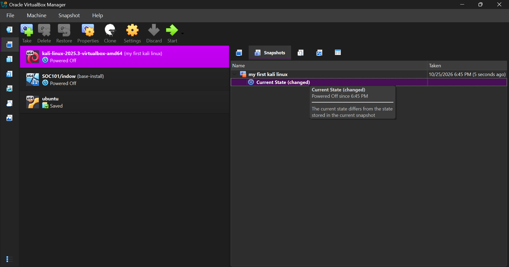
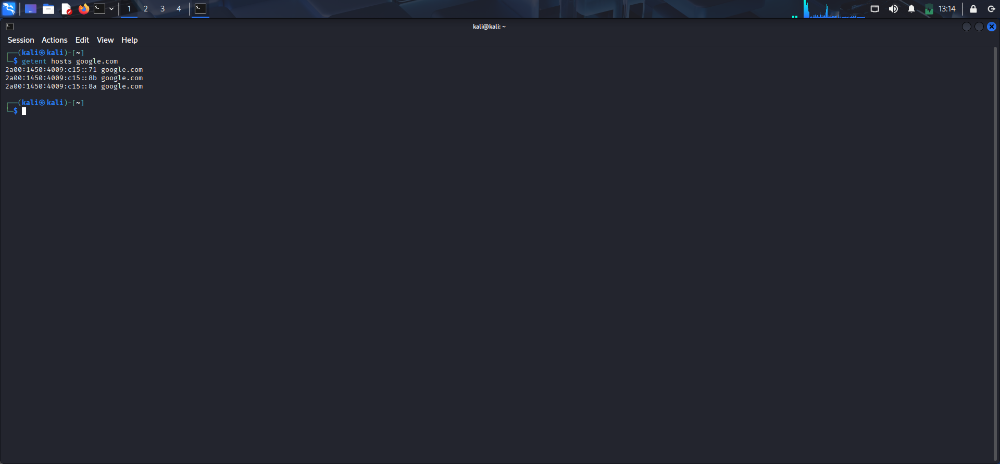

# My-Cybersecurity-Lab
my Cybersecurity lab setup

A personal learning log for building a Kali Linux virtual machine in VirtualBox and connecting it to a NAT Network. This project records my own setup and verification evidence.

> The reference repository linked under Credits inspired the lab topic. This README and its screenshots document my own virtual machines and configuration.

## Lab configuration

| Item | My setup |
|---|---|
| Host | Windows |
| Hypervisor | Oracle VirtualBox |
| Virtual machine | `kali-linux-2025.3-virtualbox-amd64` |
| Kali memory | 2048 MB |
| Network mode | NAT Network |
| NAT Network name | `NatNetwork` |
| IPv4 prefix | `10.0.0.0/24` |
| NAT DHCP | Enabled on the VirtualBox network |
| Kali IPv4 method | Manual/static |
| Kali address | `10.0.0.2/24` |
| Gateway | `10.0.0.1` |
| DNS servers | `8.8.8.8`, `1.1.1.1` |
| Kali adapter | Adapter 1, Intel PRO/1000 MT Desktop (82540EM) |
| Snapshot | `my first kali linux` |

## Setup walkthrough

### 1. VirtualBox Manager

VirtualBox Manager is used to manage the Kali virtual machine and the lab network.


### 2. Kali virtual machine settings

The VM settings identify the Kali Linux 2025.3 appliance. The system is allocated 2048 MB of memory.


### 3. Create and configure the NAT Network

The NAT Network is named `NatNetwork` and uses `10.0.0.0/24`. DHCP is enabled on the VirtualBox NAT Network; IPv6 is disabled.


### 4. Connect Kali to the NAT Network

Adapter 1 is enabled and attached to the `NatNetwork` NAT Network using the Intel PRO/1000 MT Desktop adapter. The screenshot shows Promiscuous Mode set to `Allow All`.


### 5. Configure Kali with a static IPv4 address

Kali's `Wired connection 1` profile is set to **Manual** with address `10.0.0.2`, prefix `24`, gateway `10.0.0.1`, and DNS `8.8.8.8`.


### 6. Save a VM snapshot

A snapshot named `my first kali linux  was created. VirtualBox shows that the current state has changed since the snapshot was taken, so this is a checkpoint rather than proof that the current VM exactly matches the saved snapshot.



 ### VM snapshot

A snapshot named `Static IP Verified` was created after verifying the static IPv4 address and DNS resolution.


### 7. Verify the static address and connectivity

The final terminal capture shows:

- `eth0` has address `10.0.0.2/24` without the `dynamic` label.
- The default route uses gateway `10.0.0.1` and is marked `static`.
- Four pings to `8.8.8.8` succeeded with 0% packet loss.


Earlier, Kali received `10.0.0.3/24` dynamically from DHCP. This screenshot records the state before the static setting was applied.


DNS resolution also succeeded with `getent hosts google.com`.



## Verification commands

These commands were used to inspect the Kali network configuration and test connectivity:

```bash
ip -4 addr
ip route
ping -c 4 8.8.8.8
```

## Safety

Use this lab only for learning and for systems that I own or have explicit permission to test. Keep security exercises within the virtual lab unless there is a clear, authorized reason to connect elsewhere.

## Credits

Lab topic inspiration: [Cybersecurity Lab Setup](https://github.com/waqasulkarim/Cybersecurity-Lab-Setup1). This project is an independently written record of my own lab configuration and learning.
